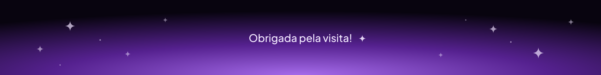

  

 

<table>
  <tr>
    <td width="62%" valign="middle">
      <h2>About Me</h2>
      

        Sou estudante de <strong>Análise e Desenvolvimento de Sistemas</strong> e estou construindo minha trajetória na área de tecnologia, com o objetivo de 
        me tornar desenvolvedora web.
      

      

        Meu interesse também envolve design gráfico, áreas que complementam minha visão sobre o desenvolvimento de soluções digitais. 
        Gosto de explorar novas ferramentas, conhecer diferentes tecnologias e descobrir cada vez mais possibilidades dentro da área de TI.
      

    </td>
    <td width="38%" align="center" valign="middle">
      
    </td>
  </tr>
</table>

 

<h2 align="left">Skills &amp; Technologies</h2>

<table>
  <tr>
    <td width="33%" align="left" valign="top">
      <h3 align="left">Development</h3>
      
      
        
      
      
        
      
      
    </td>
    <td width="33%" align="left" valign="top">
      <h3 align="left">Design</h3>
      
      
        
      
    </td>
    <td width="34%" align="left" valign="top">
      <h3 align="left">Tools</h3>
      
      
    </td>
  </tr>
</table>

 

<h2 align="left">Projects</h2>

<table>
  <tr>
    <td width="8%" align="center" valign="middle">
      
    </td>
    <td valign="middle">
      <h3>Petal House</h3>
      
<strong>HTML · CSS · JavaScript</strong>

      
Projeto de desenvolvimento web de uma floricultura, com identidade visual própria e páginas para apresentar flores, plantas e acessórios.

      <!-- Quando tiver o link do repositório, substitua o comentário por: <a href="LINK_DO_REPOSITORIO">Ver projeto</a> -->
    </td>
  </tr>
  <tr>
    <td align="center" valign="middle">
      
    </td>
    <td valign="middle">
      <h3>AlimentaAção</h3>
      
<strong>Figma · UX/UI · GitHub</strong>

      
Projeto de interface para uma iniciativa de doação de alimentos, com foco em facilitar conexões e contribuir para a redução do desperdício.

      <!-- Quando tiver o link do repositório, substitua o comentário por: <a href="LINK_DO_REPOSITORIO">Ver projeto</a> -->
    </td>
  </tr>
</table>

 

  

