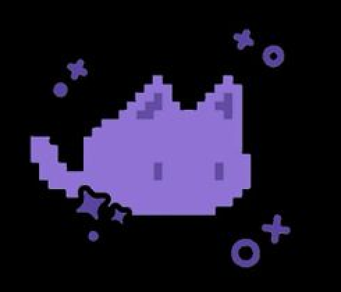

  

 

<table>
  <tr>
    <td width="62%" valign="middle">
      <h2>About Me</h2>
      

        Sou estudante de <strong>Análise e Desenvolvimento de Sistemas</strong> e estou construindo minha trajetória na área de tecnologia.
        Tenho interesse em desenvolvimento web, criação de interfaces e experiência do usuário.
      

      

        Atualmente, estudo HTML, CSS, JavaScript, Python, C e SQL, além de explorar ferramentas de design como Figma e Canva.
        Gosto de aprender na prática, desenvolver projetos e transformar ideias em soluções digitais.
      

    </td>
    <td width="38%" align="center" valign="middle">
      
    </td>
  </tr>
</table>

 

<h2 align="left">Skills &amp; Technologies</h2>

<table>
  <tr>
    <td width="33%" valign="top">
      <h3>Development</h3>
      
      
      
        
      
      
      
    </td>
    <td width="33%" valign="top">
      <h3>Design</h3>
      
      
        
      
    </td>
    <td width="34%" valign="top">
      <h3>Tools</h3>
      
      
    </td>
  </tr>
</table>

 

<h2 align="left">Projects</h2>

<table>
  <tr>
    <td width="8%" align="center" valign="middle">
      
    </td>
    <td valign="middle">
      <h3>Petal House</h3>
      
<strong>HTML · CSS · JavaScript</strong>

      
Projeto de desenvolvimento web de uma floricultura, com identidade visual própria e páginas para apresentar flores, plantas e acessórios.

      <!-- Quando tiver o link do repositório, substitua o comentário por: <a href="LINK_DO_REPOSITORIO">Ver projeto</a> -->
    </td>
  </tr>
  <tr>
    <td align="center" valign="middle">
      
    </td>
    <td valign="middle">
      <h3>AlimentaAção</h3>
      
<strong>Figma · UX/UI · GitHub</strong>

      
Projeto de interface para uma iniciativa de doação de alimentos, com foco em facilitar conexões e contribuir para a redução do desperdício.

      <!-- Quando tiver o link do repositório, substitua o comentário por: <a href="LINK_DO_REPOSITORIO">Ver projeto</a> -->
    </td>
  </tr>
</table>

 

  

